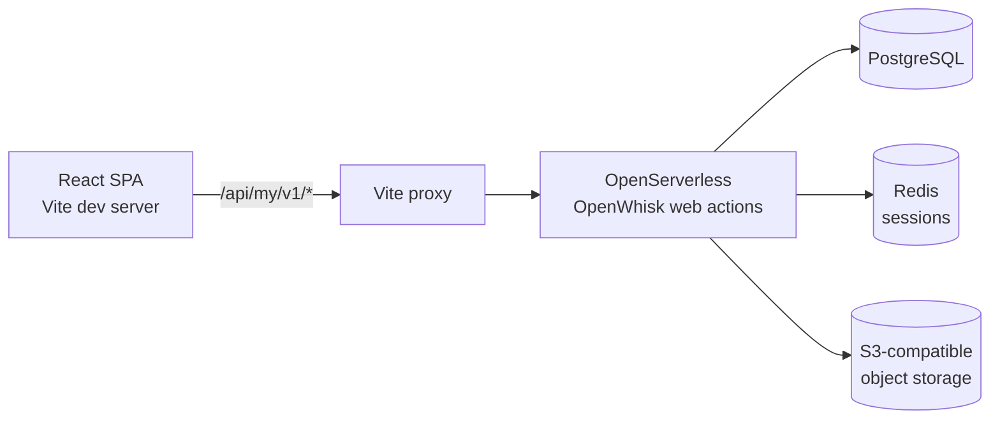

# Architecture

## Overview

MotoLab is a serverless single-page application. The frontend is a React SPA
served by Vite; the backend is a set of independent Python OpenServerless web
actions. There is no long-running backend server process.



## Frontend

```
src/
├── components/        UI components, Layout, icons, MotorcycleSelector
│   └── ui/            shadcn/ui primitives (button, card, dialog, select, ...)
├── contexts/          AuthContext (session bootstrap), GarageContext (selected moto)
├── lib/               api.ts (fetch client + token), utils.ts
├── pages/             Login, Register, Dashboard, Garage, Maintenance, Components, Documents
├── types/             shared TypeScript domain types
├── App.tsx            providers + routing
└── main.tsx           entry
```

- **HashRouter** for serverless compatibility; logical paths (`/dashboard`).
- **TanStack Query** for server state; mutations invalidate related query keys.
- **AuthContext** validates the persisted opaque token through `/api/my/v1/me`
  on every full load before protected routes render. On failure the token is
  cleared and the user is sent to login.
- **GarageContext** holds the selected motorcycle id (persisted in
  `localStorage`) shared across Dashboard, Maintenance, Components, Documents.

## Backend

Each action is an independent Python module under `packages/<package>/<action>/`.
The generated `__main__.py` wires context (`ctx.REDIS`, `ctx.REDIS_PREFIX`,
`ctx.POSTGRESQL`, and for documents `ctx.S3_CLIENT`/`ctx.S3_DATA`) and calls the
editable module. Modules return application JSON; the wrapper nests it as
`{"body": <module return>}`, which OpenWhisk serves as the HTTP body — so the
browser receives the module dict directly.

### Actions

| Endpoint | Responsibility |
|----------|----------------|
| `v1/register` | Create user (bcrypt) + issue session token |
| `v1/login` | Verify password + issue session token |
| `v1/me` | Validate token, return current user |
| `v1/logout` | Delete session record |
| `v1/motorcycles` | Motorcycle CRUD (ownership-scoped) |
| `v1/maintenance` | Maintenance CRUD + history |
| `v1/components` | Component CRUD |
| `v1/documents` | S3 presigned upload/download + metadata |
| `v1/dashboard` | Aggregated real-time overview |
| `setup/database` | Idempotent schema initialization (private) |

### Request flow (auth)

1. Browser `POST /api/my/v1/login` with email + password.
2. Action verifies bcrypt hash, generates `secrets.token_urlsafe(32)`, stores
   `{REDIS_PREFIX}session:{token} -> user_id` in Redis with a 7-day TTL.
3. Browser persists only the opaque token.
4. Every protected request sends `Authorization: Bearer <token>`; the action
   reads the Redis record, derives `user_id`, refreshes TTL, and rejects when
   absent or expired.
5. `logout` deletes the Redis record.

### Document upload flow

1. `POST /api/my/v1/documents {action:"upload-url"}` → presigned S3 PUT URL + `s3Key`.
2. Browser PUTs the file directly to object storage.
3. `POST /api/my/v1/documents {action:"confirm"}` → action `head_object`s the key
   to verify the upload, then stores document metadata in PostgreSQL.
4. `GET /api/my/v1/documents/{id}` → presigned GET URL for download.

## Design system

Cyber-industrial / motorsport theme: dark-first surfaces (`#0B0D10`/`#12171D`/`#181F27`),
acid-green (`#B4FF78`) primary, cyan (`#55D9F5`) secondary, sharp geometry
(0.25rem radius), hairline separators, tabular numerals for diagnostic readouts.
Defined as HSL CSS variables in `src/index.css` and consumed via Tailwind tokens.
