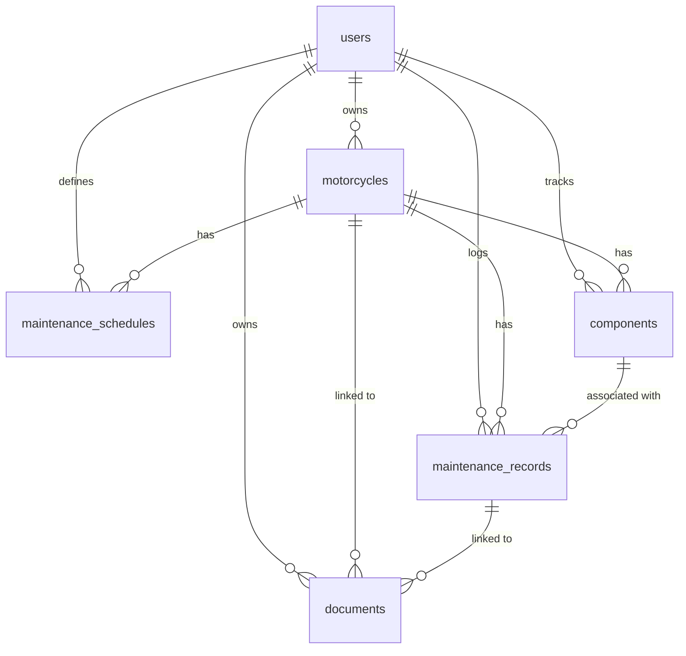

# Database

PostgreSQL is the primary relational store. The schema is created idempotently by
the private action `packages/setup/database/database.py` using `CREATE TABLE IF
NOT EXISTS` and `CREATE INDEX IF NOT EXISTS`, so re-running `ops ide setup` is
non-destructive.

## Entity Relationship

## Tables

### users
| Column | Type | Notes |
|--------|------|-------|
| id | BIGSERIAL | PK |
| email | TEXT | UNIQUE, NOT NULL |
| password_hash | TEXT | bcrypt |
| name | TEXT | |
| created_at | TIMESTAMPTZ | default now() |

### motorcycles
| Column | Type | Notes |
|--------|------|-------|
| id | BIGSERIAL | PK |
| owner_id | BIGINT | FK → users(id) ON DELETE CASCADE |
| brand, model | TEXT | NOT NULL |
| year | INTEGER | |
| engine_displacement | INTEGER | cc |
| registration_date | DATE | |
| current_mileage | INTEGER | default 0 |
| vin | TEXT | optional |
| notes | TEXT | |
| photo_url | TEXT | |
| created_at, updated_at | TIMESTAMPTZ | |

Index on `owner_id`.

### maintenance_records (auditable history)
| Column | Type | Notes |
|--------|------|-------|
| id | BIGSERIAL | PK |
| motorcycle_id | BIGINT | FK → motorcycles CASCADE |
| owner_id | BIGINT | FK → users CASCADE |
| category | TEXT | one of the maintenance categories |
| operation_date | DATE | NOT NULL |
| mileage | INTEGER | |
| cost | NUMERIC(12,2) | |
| notes | TEXT | |
| component_id | BIGINT | FK → components ON DELETE SET NULL |
| created_at, updated_at | TIMESTAMPTZ | |

Indexes on `motorcycle_id`, `owner_id`.

### maintenance_schedules (user-defined reminders)
| Column | Type | Notes |
|--------|------|-------|
| id | BIGSERIAL | PK |
| motorcycle_id, owner_id | BIGINT | FK CASCADE |
| category | TEXT | |
| interval_mileage | INTEGER | mileage-based |
| interval_days | INTEGER | time-based |
| last_performed_mileage | INTEGER | |
| last_performed_date | DATE | |
| verified | BOOLEAN | false = manually configured, true = manufacturer-confirmed |
| notes | TEXT | |

### components
| Column | Type | Notes |
|--------|------|-------|
| id | BIGSERIAL | PK |
| motorcycle_id, owner_id | BIGINT | FK CASCADE |
| name | TEXT | NOT NULL |
| category | TEXT | |
| installation_date, installation_mileage | | |
| replacement_date, replacement_mileage | | |
| expected_maintenance_interval | INTEGER | km |
| notes | TEXT | |

Indexes on `motorcycle_id`, `owner_id`.

### documents
| Column | Type | Notes |
|--------|------|-------|
| id | BIGSERIAL | PK |
| owner_id | BIGINT | FK → users CASCADE |
| motorcycle_id | BIGINT | FK → motorcycles CASCADE |
| maintenance_id | BIGINT | FK → maintenance_records ON DELETE SET NULL |
| filename | TEXT | NOT NULL |
| content_type | TEXT | |
| size_bytes | BIGINT | |
| s3_key | TEXT | NOT NULL |
| doc_type | TEXT | receipt, manual, photo, invoice, document |
| created_at | TIMESTAMPTZ | |

Indexes on `motorcycle_id`, `owner_id`.

## Ownership

Every motorcycle-scoped row carries `owner_id` copied from the authenticated
session. Queries filter by `owner_id` in addition to the resource id, so a user
can never read or mutate another user's data even with a guessed id.

## Maintenance Categories

`engine_oil`, `oil_filter`, `air_filter`, `spark_plugs`, `brakes`,
`brake_fluid`, `chain`, `sprockets`, `tires`, `battery`, `coolant`,
`general_inspection`, `other`.
